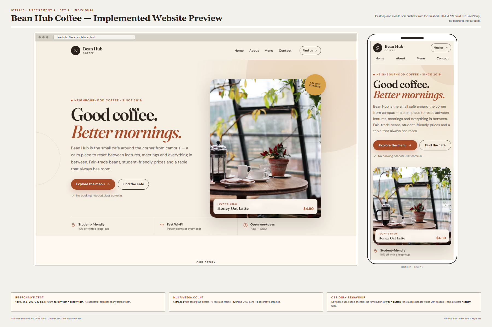

# Bean Hub Coffee

A single-page multimedia website for a small community coffee shop, built for
**ICT2215 Web Design and Development with Multimedia — Assessment 2 (Set A)**.

**HTML5 + CSS3 only.** No JavaScript, no carousel, no backend, no database and no login system.

> **Live site:** `https://YOUR-GITHUB-USERNAME.github.io/bean-hub-coffee/`
> **Repository:** `https://github.com/YOUR-GITHUB-USERNAME/bean-hub-coffee`
>
> Replace the two placeholders above after publishing. The repository name used in this guide is
> `bean-hub-coffee`.



## About the project

Bean Hub Coffee is a fictional neighbourhood café two minutes from the Riverside campus and a
short walk from the office district. The site speaks to two audiences:

- **University students** who need affordable coffee, Wi-Fi and a place to study between classes.
- **Nearby office workers** who want a fast, good coffee and a quiet table for an informal meeting.

The website is one landing page with four anchored sections — **Home**, **About**,
**Products / Services** and **Contact** — and a display-only contact form.

## Features

| Requirement | Implementation |
|---|---|
| Working navigation menu | Sticky header with four native anchor links |
| Home / About / Products / Contact | Separate `<section>` elements with matching `id`s |
| Display-only contact form | Labelled fields; button is `type="button"`; no form `action` |
| At least 3 images | 6 photographs, all with descriptive `alt` text |
| At least 1 embedded video | One responsive 16:9 YouTube iframe |
| At least 3 icons / graphics | 12 inline SVG icon symbols, reused 22 times, plus 3 decorative graphics |
| CRAP principles | Contrast, repetition, alignment and proximity documented and visible |
| Consistent palette / type | CSS custom properties; Fraunces + DM Sans |
| Responsive layout | Media queries at 1024, 900, 720 and 520 px |
| No horizontal scroll | Tested at 1440, 768, 390 and 320 px (`scrollWidth === clientWidth`) |
| No JavaScript | Zero `<script>` tags and no inline event handlers |

## Run locally

No build step is required.

1. Download or clone this repository.
2. Open `index.html` in a web browser.
3. Use the header links to move between the four sections.

For a local server (optional):

```bash
python -m http.server 8000
```

Then open <http://localhost:8000/>.

An internet connection is needed for Google Fonts, the six Unsplash photographs and the YouTube
iframe. If YouTube is blocked, use the “Watch on YouTube” fallback link under the video copy.

## Project structure

```text
bean-hub-coffee/
├── index.html                  # single landing page, HTML + comments
├── style.css                   # complete external stylesheet
├── design/                     # wireframes, palette, typography and site preview
├── evidence/                   # desktop / tablet / mobile screenshots and test results
├── ICT2215_A2_BeanHub_Coffee_Design_Plan.docx
├── ICT2215_A2_BeanHub_Coffee_Design_Plan.pdf
├── README.md
├── CREDITS.md                  # third-party assets and licences
├── LICENSE                     # MIT licence for original code and documentation
├── PUBLISHING.md               # GitHub Pages checklist for this project
└── .nojekyll                   # tells GitHub Pages to serve the files as-is
```

## Publish with GitHub Pages

The full beginner workflow is in [`PUBLISHING.md`](PUBLISHING.md). The short version:

1. Create a **public** repository named `bean-hub-coffee`.
2. Upload the contents of this folder. Keep `index.html` at the repository root.
3. Go to **Settings → Pages**.
4. Under **Build and deployment**, choose **Deploy from a branch**.
5. Select branch **main** and folder **/(root)**, then click **Save**.
6. Wait for the deployment message and open:

```text
https://YOUR-GITHUB-USERNAME.github.io/bean-hub-coffee/
```

Do not put `index.html` inside another folder — GitHub Pages must find it at the repository root.

## Updating the site

After editing locally:

1. Change `index.html`, `style.css` or the image URLs.
2. Upload the changed files to the repository, replacing the old versions.
3. Commit the changes.
4. Wait for GitHub Pages to redeploy.
5. Refresh the live URL.

## Replacing placeholder assets

**Image:** replace the `src` URL and update the `alt` text. Keep the `width` and `height` attributes
so the layout does not shift while the image loads.

**Video:** replace `6YMgB61WyvE` in the iframe URL with your own YouTube video ID. Keep the
`title`, `loading="lazy"` and `allowfullscreen` attributes.

See [`CREDITS.md`](CREDITS.md) for the full list of third-party assets.

## Design rationale

Warm oat and espresso neutrals keep the page calm; one terracotta accent makes every action easy to
find; Fraunces gives the café a human voice; DM Sans keeps the reading experience clear; and a
single 1120 px grid with four content-driven breakpoints keeps the layout aligned and phone-safe.

## Licence

Original code and documentation: **MIT License** — see [`LICENSE`](LICENSE).

Third-party photographs, fonts and video remain under their own licences; see
[`CREDITS.md`](CREDITS.md).

## Assessment note

This is a student project for ICT2215 Assessment 2. The design plan, code comments and demonstration
script were prepared with AI assistance and reviewed, tested and adapted by the student. The student
should be able to explain every part of the website during the live demonstration.

